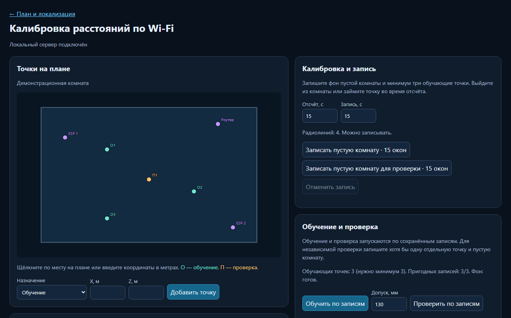

# WiFi DensePose

**Локальная система Wi-Fi-зондирования на ESP32-S3.** Платы передают измерения радиоканала (CSI) ноутбуку, а браузер показывает сигнал, движение и результаты калибровки на плане помещения.

[Быстрый старт](#быстрый-старт) · [Подключение ESP32](#подключение-esp32) · [Экраны и возможности](#экраны-и-возможности) · [Документация](#документация) · [Источники и лицензии](#источники-и-лицензии)

## Быстрый старт

Скачайте исходники через **Code → Download ZIP** на GitHub и распакуйте архив. Если установлен Git, можно клонировать репозиторий.

```bash
git clone https://github.com/EEGRINO/wifi-densepose.git
cd wifi-densepose
```

### Windows

1. Установите [Python 3.12 для Windows](https://www.python.org/downloads/windows/) с опцией **Add python.exe to PATH**. Поддерживается Python 3.11 и новее.
2. Дважды щёлкните [**`Start-Windows.cmd`**](Start-Windows.cmd) в распакованной папке или запустите его из PowerShell.

```powershell
.\Start-Windows.cmd
```

Команда создаёт локальное окружение, устанавливает зависимости и открывает [план комнаты](http://127.0.0.1:8000/localization.html). Остановить оба сервера можно сочетанием **Ctrl+C** в окне запуска.

### Linux и macOS

В каталоге проекта запустите команду с Python 3.11 или новее.

```bash
python3 build_scripts/start_web.py
```

### Подготовка до подключения к роутеру без интернета

На первом запуске требуется доступ к PyPI. Подготовьте окружение заранее командой `.\Start-Windows.cmd --setup-only` в Windows или `python3 build_scripts/start_web.py --setup-only` в Linux и macOS. После этого запустите ту же команду без `--setup-only`. План, точки дальности и офлайн-обучение работают в локальной сети. Для 3D-карты и калибровки с камерой браузер загружает библиотеки с CDN.

План комнаты открывается и без плат. Для измерений подключите оборудование по инструкции ниже.

## Подключение ESP32

Для записи точек дальности нужны **две ESP32-S3**, роутер с сетью **2,4 ГГц** и ноутбук в той же подсети. Ноутбук можно подключить к роутеру кабелем Ethernet.

1. Если платы ещё не прошиты, выберите профиль под маркировку модуля и залейте прошивку вместе с LittleFS. [Прошивка и профили плат](docs/technical.md#прошивка-платы-для-начинающих).
2. Подключите платы к одному роутеру. В настройках каждой ESP укажите **локальный IP ноутбука в сети роутера** и UDP-порт **5555**. В Windows нужный IPv4-адрес покажет `ipconfig`. [Настройка новой платы](docs/technical.md#первый-запуск-и-captive-portal).
3. Запустите программу и проверьте, что в панели **«Качество приёма»** на плане видны измерения обеих ESP. Диагностические сообщения появятся в окне запуска.
4. Сохраните контур комнаты и положения устройств. На странице **«Калибровка расстояний»** запишите пустую комнату и минимум три точки обучения, затем нажмите **«Обучить по записям»**. Для оценки погрешности отдельно запишите контрольные точки и контрольную пустую комнату.

## Экраны и возможности

После запуска откройте нужную страницу на том же компьютере.

| Экран | Для чего |
| --- | --- |
| [План и локализация](http://127.0.0.1:8000/localization.html) | Разметить контур, указать устройства, проверить качество CSI и обучить модель секторов |
| [Калибровка расстояний](http://127.0.0.1:8000/ranging.html) | Добавить и удалить точки, записать фон, обучить модель по записям и проверить ошибку на отдельных точках |
| [Радиовизор](http://127.0.0.1:8000/radioview.html) | Следить за клетками на плане и вращать обзор с позиции каждой ESP |
| [3D-карта](http://127.0.0.1:8000/map3d.html) | Наблюдать телеметрию, изменения сигнала и оценку присутствия |
| [Калибровка позы с камерой](http://127.0.0.1:8000/camera_calib.html) | Записать пары CSI и 16 суставов, обучить экспериментальную модель позы |



*Интерфейс калибровки на демонстрационных данных.*

Оценка дальности строится по измеренной позиции на плане. Точность зависит от геометрии комнаты, расстановки плат и качества сигнала. Для проверки допуска нужны измерения в независимых точках.

В радиовизоре сетка строится по сохранённому контуру. Сначала разместите ESP в редакторе плана, затем выберите IP каждого приёмника на странице радиовизора. Клетка загорается по оценке локализации или модели дальности, предыдущая плавно гаснет. В обзоре ESP зерно на чёрном фоне меняется по исходным отсчётам I/Q выбранного приёмника. Автоэкспозиция и ползунок «Яркость зерна» влияют только на его отображение. Силуэт строится как визуализация свежей 2D-оценки суставов основного ESP в оценённой точке комнаты. Для обучения суставов один раз используйте [калибровку с камерой](http://127.0.0.1:8000/camera_calib.html). После обучения обзору нужны только свежий CSI и положение по радиоданным.

## Диагностический журнал

Python-сервер создаёт при запуске отдельный UTF‑8 JSONL в `laptop_server/logs/` и печатает полный путь в терминале. Воспроизведите проблему и нажмите **«Скачать журнал»** в радиовизоре на компьютере с сервером. Кнопка сохраняет снимок журнала текущего запуска. Для ошибки до открытия страницы возьмите файл по пути из терминала.

Если зерно есть, а клетка не загорается, найдите `csi.summary`, затем `position.changed` и `browser.cell`. В поле `live_state` видно, есть ли обученная модель, а `live_reason` поясняет, например, близость к фону (`near_background`) или выход за область обученных точек (`outside_calibration`). Если клетка видна, а силуэт пропал, найдите причину в `browser.silhouette`.

Файл хранит до 2 МиБ событий с сохранением сведений о старте. При следующем запуске удаляются журналы старше 14 дней и оставляются до 20 последних файлов. Приёмники и радиолинии в файле обозначены псевдонимами текущего запуска.

## Решение проблем

| Симптом | Что проверить |
| --- | --- |
| Программа завершилась на установке | Версию Python и доступ к PyPI. Посмотрите сообщение в окне запуска |
| Порт 8000 или 8765 занят | Закройте окно предыдущего запуска или откройте [действующий интерфейс](http://127.0.0.1:8000/localization.html) |
| Страница открылась, а кадры CSI отсутствуют | IP ноутбука в настройках ESP, общий роутер, UDP 5555, правила брандмауэра и питание обеих плат |
| Кнопка обучения недоступна | Сохранённый план, запись фона и минимум три точки с пригодными записями |
| 3D или камера не загружаются | Доступ браузера к CDN и разрешение на камеру для `127.0.0.1` |

## Документация

- [Техническое руководство](docs/technical.md) — прошивка, роутер, ESP, форматы пакетов, ручной запуск и настольный клиент.
- [Локализация по CSI](laptop_server/LOCALIZATION_RU.md) — геометрия помещения, запись и модель секторов.
- [Уведомления о сторонних компонентах](THIRD_PARTY_NOTICES.txt) — лицензии моделей и зависимостей.

| Каталог | Содержимое |
| --- | --- |
| [`firmware/`](firmware/) | Исходники и веб-интерфейс ESP32-S3 |
| [`laptop_server/`](laptop_server/) | Приём CSI по UDP, обработка, WebSocket и веб-страницы |
| [`desktop_app/`](desktop_app/) | Дополнительный клиент PyQt6 |
| [`build_scripts/`](build_scripts/) | Запуск веб-интерфейса и сборка настольного клиента |

## Источники и лицензии

### Литература и проекты

1. Geng J., Huang D., De la Torre F. *DensePose From WiFi*. 2022. arXiv:2301.00250. Подготовка амплитуды и фазы CSI в [`densepose_input.py`](laptop_server/densepose_input.py) опирается на § 3.1. Идея отложенной проверки из § 4 адаптирована в [калибровке дальности](laptop_server/ranging_web.py) к трём временным блокам внутри каждой записи. Для оценки точности по комнате используются отдельные контрольные точки. [Статья](https://arxiv.org/abs/2301.00250).
2. Wang F., Zhou S., Panev S., Han J., Huang D. *Person-in-WiFi: Fine-Grained Person Perception Using WiFi*. ICCV 2019, с. 5452–5461. Идея сопоставлять измерения CSI и кадры с разметкой по времени реализована в [калибровке с камерой](laptop_server/static/csi_pose_sync.js). Она подбирает ближайший CSI-кадр с разницей до 80 мс. [Статья](https://openaccess.thecvf.com/content_ICCV_2019/html/Wang_Person-in-WiFi_Fine-Grained_Person_Perception_Using_WiFi_ICCV_2019_paper.html), [инструменты авторов](https://github.com/geekfeiw/wifiperson).
3. Güler R. A., Neverova N., Kokkinos I. *DensePose: Dense Human Pose Estimation in the Wild*. CVPR 2018, с. 7297–7306. Справочный источник для плотного сопоставления поверхности тела с изображением. Текущая калибровка с камерой выдаёт 16 суставов. [Статья](https://arxiv.org/abs/1802.00434), [реализация DensePose в Detectron2](https://github.com/facebookresearch/detectron2/tree/main/projects/DensePose).
4. rUv. *RuView*. Визуальный ориентир для интерфейса телеметрии. Источник унаследованных файлов моделей перечислен с ревизиями в уведомлениях. [Репозиторий](https://github.com/ruvnet/RuView), [демо](https://ruvnet.github.io/RuView/), [модели](https://huggingface.co/ruv/ruview).

Для подготовки CSI, синхронизации с камерой и оценки по временным блокам написан локальный код по описанным методам. Обучение использует записи с вашей аппаратуры.

### Использование и распространение

[Уведомления о сторонних компонентах](THIRD_PARTY_NOTICES.txt) перечисляют проверенные файлы RuView, условия для зависимостей и материалы с неустановленным происхождением. Оригинальный текст MIT для подтверждённых файлов находится [рядом с моделями](laptop_server/models/LICENSE.ruview.txt). Общую лицензию на исходный код этого репозитория пока предстоит оформить с правообладателями.

В РФ авторское право не распространяется на идеи и методы согласно п. 5 ст. 1259 ГК РФ. Использование конкретного кода, текста и иллюстраций зависит от правового основания и условий правообладателя. Для цитирования действует ст. 1274, а для открытых лицензий предусмотрена ст. 1286.1. [Ст. 1259 ГК РФ](https://www.consultant.ru/document/cons_doc_LAW_64629/be05678dc42ddc67aae5be9ba9beebd367fb9a3f/), [ст. 1229](https://www.consultant.ru/document/cons_doc_LAW_64629/98ad2641f95945c4b7956150260564c8b44028d9/), [ст. 1274](https://www.consultant.ru/document/cons_doc_LAW_64629/84bbd636598a59112a4fe972432343dd4f51da1d/), [ст. 1286.1](https://www.consultant.ru/document/cons_doc_LAW_64629/e0c0d28fc67b7998751c3a7f98f6be9dfb789911/).

Ориентир для структуры быстрого старта и навигации по документации. [ADO — Rostelekom-project](https://github.com/pipupupiup/Rostelekom-project).
